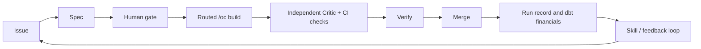

# Twenty-second peer pitch and adoption cheat sheet

Portable summary of the software factory on `main` (release `v0.1.0`). Copy this file with the template or share the link in onboarding.

## Say this out loud (~20 seconds)

**Issues are the production line:** tag selected work, approve a short spec, comment `/oc run`—Actions opens a standard PR with metered cost and a run record. **Humans keep judgment:** trivial doc-only work can merge on green CI; anything that changes product behavior waits for an explicit gate on the PR. **Same rails every time**—spec shape, checks, spend trail—so you compare quality and dollars per issue, not per chat.

## Factory loop (one screen)



Deep playbook: [`.factory/FACTORY.md`](../.factory/FACTORY.md). Vision and default worker path: [`.factory/VISION.md`](../.factory/VISION.md).

## Drop it into any repo

| Step | Command / doc | What it does |
|---|---|---|
| 1 — Bootstrap | `python3 scripts/factory-init-repo.py` · [docs/INIT_REPO.md](INIT_REPO.md) | Stamp `.factory/`, `scripts/`, pinned reusable-workflow **callers**, and doc-map starters into a target repo. |
| 2 — Harden | `bash scripts/harden-repo.sh` | Owner-only: ruleset / protection, Dependabot, secret scanning where the plan allows, one-time gitleaks history pass. |
| 3 — Verify | `python3 scripts/factory-doctor.py` · [docs/DOCTOR.md](DOCTOR.md) | Offline readiness scorecard (mode, artifacts, models budget, protected scripts, workflow audit, docs links). Add `--public` for the pre-public hygiene pass. |
| 4 — Pilot | [docs/PILOT_RUNBOOK.md](PILOT_RUNBOOK.md) | Run one low-risk issue end to end on a pinned tag (`v0.1.0`); migrate older copies with `factory-migrate-adopter.py` when needed. |

**Reusable workflows** — product repos keep thin caller YAML that pins a template tag; shared bodies live in the template repo:

- [docs/reusable-workflows/](reusable-workflows/README.md) — `workflow_call` bundles for `/oc run`, spec, fix, pr-check, and factory site refresh.
- CLI index: [docs/CLI.md](CLI.md) · `python3 scripts/factory-cli.py list`

**Adoption reading list**

- [ADOPTING.md](../ADOPTING.md) — labels, `/oc` commands, merge rules, agent hard rules.
- [docs/SETUP.md](SETUP.md) — new-repo checklist, secrets *names*, branch protection, site hosting.

**Docs and public hygiene (offline, no network)**

```bash
python3 scripts/factory-check-docs.py            # human-readable link + anchor report
python3 scripts/factory-check-docs.py --strict   # CI-friendly non-zero on broken links
python3 scripts/factory-prepublic-check.py       # before making the repo public
python3 scripts/factory-prepublic-check.py --strict
python3 scripts/factory-doctor.py --public       # doctor + prepublic in one pass
python3 scripts/factory-cost-digest.py --help    # weekly spend rollup from run records
bash scripts/test-factory-check-docs.sh
bash scripts/test-factory-prepublic-check.sh
```

## One-page operator reminders

| Topic | Where |
|---|---|
| Select work | `factory:selected` label — only selected issues get spec + `/oc run`. |
| Kickoff | Owner comment `/oc spec`, then `/oc run` on the issue; `/oc fix` on the bot PR branch. |
| Never merge | Workers and agents; manager merges trivial only when risk class and CI allow. |
| Required checks | `pr-check`, `run-records`, `gitleaks` green on the PR head; branch 0 behind default. |
| Spend | Run records under `factory/runs/`, dbt marts + factory site for financials; caps in owner-only `factory/budget.yml` and `.factory/models.yaml`. |
| Feedback into the method | Append [`.factory/DECISIONS.md`](../.factory/DECISIONS.md); cross-repo factory bugs file here with `from-product`. |