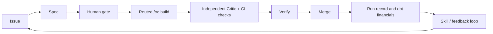

# Twenty-second peer pitch and adoption cheat sheet

Portable summary of the software factory on `main`. Copy this file with the template or share the link in onboarding.

## Say this out loud (~20 seconds)

**We treat GitHub issues as the production line:** you label what matters, approve a short spec, and kick off an Actions worker that opens a standard PR with run records and cost baked in. **Humans still own judgment** — trivial doc-only fixes can merge on green CI, but anything that changes product behavior waits for a real gate on the PR body. **The boring parts repeat every time** — same spec shape, same checks, same financials trail — so you can compare quality and spend issue to issue instead of re-inventing process in chat.

## Factory loop (one screen)



Deep playbook: [`.factory/FACTORY.md`](../.factory/FACTORY.md). Vision and default worker path: [`.factory/VISION.md`](../.factory/VISION.md).

## Drop it into any repo

| Step | Command / doc | What it does |
|---|---|---|
| 1 — Bootstrap | `python3 scripts/factory-init-repo.py` *(planned #37)* | Copy `.factory/`, `scripts/`, `.github/` stubs, and per-repo doc map starters. **Today:** manual copy per [docs/SETUP.md](SETUP.md) §1. |
| 2 — Harden | `bash scripts/harden-repo.sh` | Owner-only: ruleset / protection, Dependabot, secret scanning where the plan allows, one-time gitleaks history pass. |
| 3 — Verify | `python3 scripts/factory-doctor.py` *(planned #178)* | Offline readiness checks (labels, secrets names, hooks, docs links). **Today:** [docs/SETUP.md](SETUP.md) “Check the install” and `python3 scripts/factory-check-docs.py`. |

**Adoption reading list**

- [ADOPTING.md](../ADOPTING.md) — labels, `/oc` commands, merge rules, agent hard rules.
- [docs/SETUP.md](SETUP.md) — new-repo checklist, secrets *names*, branch protection, site hosting.
- `docs/DOCTOR.md` *(planned #178)* — single entry for install health; until it lands, use SETUP’s checklist and `factory-check-docs.py`.

**Docs hygiene (offline, no network)**

```bash
python3 scripts/factory-check-docs.py            # human-readable report
python3 scripts/factory-check-docs.py --strict   # CI-friendly non-zero on broken links
bash scripts/test-factory-check-docs.sh          # fixture suite
```

## One-page operator reminders

| Topic | Where |
|---|---|
| Select work | `factory:selected` label — only selected issues get spec + `/oc run`. |
| Kickoff | Owner comment `/oc spec`, then `/oc run` on the issue; `/oc fix` on the bot PR branch. |
| Never merge | Workers and agents; manager merges trivial only when risk class and CI allow. |
| Required checks | `pr-check`, `run-records`, `gitleaks` green on the PR head; branch 0 behind default. |
| Spend | Run records under `factory/runs/`, dbt marts + factory site for financials; caps in owner-only `factory/budget.yml` and `.factory/models.yaml`. |
| Feedback into the method | Append [`.factory/DECISIONS.md`](../.factory/DECISIONS.md); cross-repo factory bugs file here with `from-product`. |